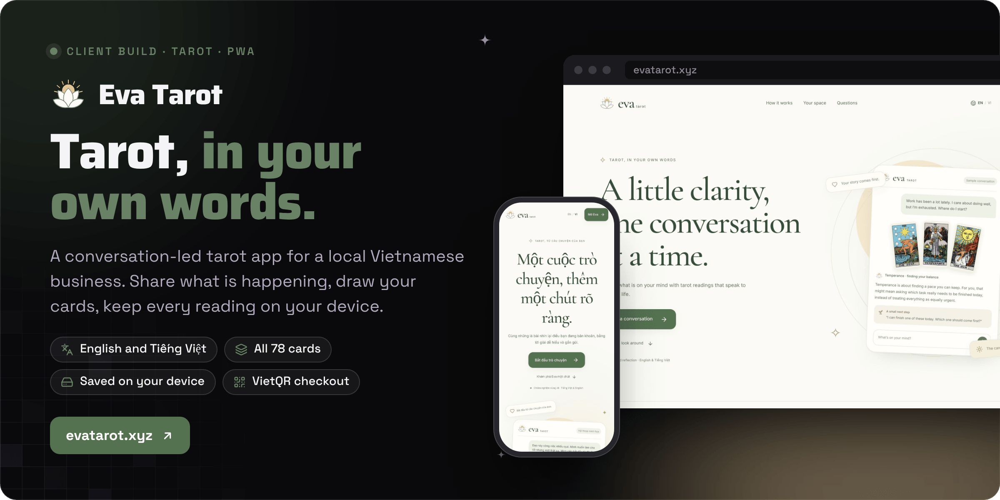

<div align="center">



<br><br>

<a href="https://evatarot.xyz"></a>&nbsp;&nbsp;
<a href="TESTING.md"></a>&nbsp;&nbsp;
<a href="DESIGN.md"></a>

<br><br>

<a href="https://github.com/operatoruplift/eva-tarot/actions/workflows/ci.yml"></a>
<a href="https://evatarot.xyz"></a>


<h3>A little clarity, one conversation at a time.</h3>

<b>Ask</b> &nbsp;→&nbsp; <b>Draw</b> &nbsp;→&nbsp; <b>Read</b> &nbsp;→&nbsp; <b>Follow up</b> &nbsp;→&nbsp; <b>Save</b>

<br>

<a href="#how-it-works">How it works</a> &nbsp;·&nbsp;
<a href="#status">Status</a> &nbsp;·&nbsp;
<a href="#run-it-locally">Run it locally</a> &nbsp;·&nbsp;
<a href="#configuration">Configuration</a> &nbsp;·&nbsp;
<a href="#documentation">Docs</a>

</div>

<br>

<picture>
  <source media="(prefers-color-scheme: dark)" srcset="docs/readme/screens-dark.png">
  
</picture>

<p align="center"><sub>Captured from a local production build on 30 October 2026, with no AI provider connected. Step 4 is in Vietnamese and shows the app's labelled card reference ("not AI"), not an AI reply.</sub></p>

**Eva Tarot is a conversation-led tarot PWA, built as a client project for a local Vietnamese business.** You tell Eva what is going on in your own words and add a spread when you want one. The reading ties each card to your situation, and follow-ups build on the same conversation. Readings, notes and history save in your browser, the interface and card content work in English and Vietnamese, and paid replies run through a VietQR bank-transfer checkout that the owner confirms from a dashboard.

Built by Matt ([RVAClassic](https://x.com/rvaclassic), [Operator Uplift](https://operatoruplift.com)) for the client, together with its launch video and social plan, which live outside this repository. The public site is [evatarot.xyz](https://evatarot.xyz).

<br>

## How it works

<picture>
  <source media="(prefers-color-scheme: dark)" srcset="docs/readme/flow-dark.png">
  
</picture>

Online AI is the default reader, so there is no model download and no WebGPU requirement. Before the first online reply, the app explains what will be sent and waits for approval. The server then pairs your words with canonical card guidance, and the model explains each card's meaning, strengths, difficulties, advice and a clear direction in everyday paragraphs. Follow-ups use the existing conversation instead of repeating the spread, a new spread uses the latest question, and editing an earlier question keeps its own cards. When the provider or network fails, you get an honest retry, never preset text passed off as AI.

<table>
  <tr valign="top">
    <td width="33%"><b>Conversation first</b><br><sub>Ordinary messages start without cards. Add a 1, 3, 5 or 10-card spread inside the same conversation, or let simple local rules suggest one, then draw in one tap or choose each card. Rename a reading, add notes, or revise a question into a new version that keeps the original.</sub></td>
    <td width="33%"><b>Saved on the device</b><br><sub>IndexedDB autosave, history and search, calendar notes and future intentions, profile photos, and validated JSON export and import. A reading never creates a cloud account.</sub></td>
    <td width="33%"><b>Honest about AI</b><br><sub>Saved card meanings are labelled as a reference, not AI. A save indicator reports real persistence state, and a recovery screen protects an unreadable journal instead of showing an empty one.</sub></td>
  </tr>
  <tr valign="top">
    <td><b>Two languages, end to end</b><br><sub>English and Vietnamese interfaces and card content, plus ten more languages for core controls. Both readers are told to answer in the selected language; quality varies.</sub></td>
    <td><b>Payments the owner controls</b><br><sub>VietQR bank-transfer orders with immutable price snapshots and a unique <code>EVA</code> memo. The owner confirms on the dashboard, and credits are granted exactly once.</sub></td>
    <td><b>Installable PWA</b><br><sub>A standalone manifest that opens straight into chat, and a service worker that caches public app and card assets, never chat responses or journal data.</sub></td>
  </tr>
</table>

<p align="center"><sub>React 19 · TypeScript · Vite 6 · Tailwind CSS 4 · Lucide · Node HTTP server and Vercel functions · OpenAI or Vercel AI Gateway · WebLLM with Qwen3 · Supabase (Postgres, Auth, Edge Functions) · IndexedDB · VietQR · node:test</sub></p>

<br>

## Status

<table>
  <tr valign="top">
    <td width="16%" align="center"></td>
    <td>The public site and reader at <a href="https://evatarot.xyz">evatarot.xyz</a>: bilingual landing page, chat reader, pricing, donations and the owner dashboard. The last production release in the verification record is from 22 October 2026 (source <code>2454ec4</code>), and it was still the release being served when the record was last updated on 27 October.</td>
    <td width="22%"><a href="TESTING.md">Verification record</a></td>
  </tr>
  <tr valign="top">
    <td align="center"></td>
    <td>The couple-reading prompt update. It is staged on a preview deployment and not promoted: on 27 October 2026 its replies still turned reported warmth into unsupported conclusions, and the decision was to keep the free AI tier and leave the update staged.</td>
    <td><a href="docs/RELATIONSHIP_READING_QA.md">Couple-reading QA</a></td>
  </tr>
  <tr valign="top">
    <td align="center"></td>
    <td>Email-verified customer account recovery. The migration and Edge function are deployed, but the <code>VITE_CUSTOMER_ACCOUNTS_ENABLED</code> and Edge <code>EVA_ACCOUNT_ENABLED</code> gates stay off until Resend email delivery and the two-device checks pass.</td>
    <td><a href="docs/ACCOUNT_RECOVERY_OPERATIONS.md">Recovery operations</a></td>
  </tr>
  <tr valign="top">
    <td align="center"></td>
    <td>The on-device reader (WebLLM with Qwen3 0.6B or 1.7B). It is opt-in from Reader options, needs WebGPU with shader-f16 and enough memory, and some phones reload or end the page under the load.</td>
    <td><a href="https://webllm.mlc.ai/docs/user/basic_usage.html">WebLLM docs</a></td>
  </tr>
  <tr valign="top">
    <td align="center"></td>
    <td>The one-question price (stored as 25,000 VND and flagged as unclear: do not guess a replacement), the refund and terms text (<code>/terms</code> is a bilingual placeholder), and the business options in the launch-feedback review, which itself turns on no new subscription, referral credit, email campaign, analytics vendor, or price or trial change.</td>
    <td><a href="docs/FEEDBACK_DECISIONS.md">Feedback decisions</a></td>
  </tr>
</table>

<br>

## Run it locally

<table>
  <tr valign="top">
    <td width="33%"><b>Prerequisites</b><br><sub>Node 24 and npm, as in CI. An OpenAI or Vercel AI Gateway key for online replies; everything else runs without one.</sub></td>
    <td width="33%"><b>Read first</b><br><sub>The <a href="TESTING.md">verification record</a> and the hosted AI settings under <a href="#configuration">Configuration</a>, before anything can spend provider credit.</sub></td>
    <td width="33%"><b>What the checks prove</b><br><sub><code>npm test</code> runs 326 node:test cases (prompts, storage, commerce, routes, deploy tracing). Live inference, payments and reading quality need the manual checks in the verification record.</sub></td>
  </tr>
</table>

### 1. Run the app

```bash
npm ci
cp .env.example .env   # add OPENAI_API_KEY or AI_GATEWAY_API_KEY for online replies
npm run dev            # Vite on :5173 and the API on :3001, with /api proxied by Vite
```

Without a provider the app still runs: the reader says online replies are unavailable and keeps your question, and you can draw cards, open the labelled card reference, and use the calendar, history and card library. Vite on its own (without the API) supports only the optional on-device reader. Keep private `.env*` files out of source archives.

### 2. Check it the way CI does

```bash
npm test               # node --test tests/*.test.mjs
npm run build          # tsc -b && vite build into dist/
npm start              # serves dist/ and the API on PORT, default 3001
```

[CI](.github/workflows/ci.yml) runs `npm ci`, `npm test` and `npm run build` on Node 24 for every push to `main` and every pull request. One opt-in test needs `EVA_COMMERCE_TEST_DATABASE_URL` pointing at an isolated local PostgreSQL (never a hosted database) and skips without it. The build warns about the large, lazily loaded WebLLM chunks.

### 3. Try checkout without Supabase (optional)

```bash
EVA_COMMERCE_LOCAL=true EVA_LOCAL_ADMIN_TOKEN="$(openssl rand -hex 32)" npm start
# open http://localhost:3001/admin and paste the same token to confirm test orders
```

Local checkout is opt-in and ignored when `VERCEL=1`. Orders live in process memory and disappear on restart, so never point it at production traffic.

### Configuration

The settings are listed, with comments, in [`.env.example`](.env.example). Never expose a secret through a `VITE_` variable: those are compiled into the browser bundle.

| Setting | Effect |
|---|---|
| `HOSTED_AI_ENABLED=true` | Lets `/api/reading` answer. Without it the endpoint returns a clear "not enabled" error. |
| `OPENAI_API_KEY`, `OPENAI_MODEL` | Direct OpenAI, which takes precedence over the gateway. Default model `gpt-4.1`. |
| `AI_GATEWAY_API_KEY`, `AI_GATEWAY_MODEL` | Vercel AI Gateway. Default model `openai/gpt-4.1`. |
| `AI_GATEWAY_ENABLED=true` | On Vercel, uses a fresh platform OIDC token per request when no key is set. |
| `PORT`, `HOST` | Built-in server port (default `3001`) and bind address (default `0.0.0.0`). |
| `VITE_SUPABASE_URL`, `VITE_SUPABASE_PUBLISHABLE_KEY` | Public Supabase coordinates for the browser build. |
| `SUPABASE_URL`, `SUPABASE_PUBLISHABLE_KEY` | The same project, for the server proxy. |
| `EVA_COMMERCE_INTERNAL_KEY` | Server-only 256-bit key. Only its SHA-256 hash is stored in `eva_server_credentials`. |
| `EVA_PRICING_MODE` | `free_trial` by default. Paid and trial modes fail closed when commerce is unavailable. |
| `EVA_COMMERCE_LOCAL`, `EVA_LOCAL_ADMIN_TOKEN` | The in-memory local checkout and its owner token. Ignored on Vercel. |
| `PAYMENT_WEBHOOK_PROVIDER` | `sepay` with `SEPAY_WEBHOOK_API_KEY`, or `payos` with `PAYOS_CLIENT_ID`, `PAYOS_API_KEY` and `PAYOS_CHECKSUM_KEY`. |
| `VITE_CUSTOMER_ACCOUNTS_ENABLED` | Shows customer account recovery. Keep it off until email delivery is verified. |

<details>
<summary><b>Hosted AI settings, costs and limits</b></summary>
<br>

- `/api/reading` requires `HOSTED_AI_ENABLED=true` and a provider. `OPENAI_API_KEY` takes precedence over `AI_GATEWAY_API_KEY`. On Vercel, `AI_GATEWAY_ENABLED=true` enables a fresh platform OIDC token per request without copying credentials into the client.
- The default hosted model is `openai/gpt-4.1` through the gateway (`gpt-4.1` for direct OpenAI), chosen after live Vietnamese editorial comparisons. It costs more per reading than the previous mini model; the project budget and request and output limits stayed the same. Override it with `AI_GATEWAY_MODEL` or `OPENAI_MODEL`.
- Missing configuration, billing rejection, timeouts and incomplete answers return explicit errors. `/api/health` confirms configuration only; a real reading is the only proof of billing and inference.
- Readings use familiar language and examples tied to the conversation. Vietnamese first readings get native-language writing instructions and keep all five card sections. The server supplies canonical symbolism, strengths and risks, then generates advice from the user's circumstances instead of fixed card exercises. Follow-up clarifications stay brief. These instructions guide the model; they do not guarantee perfect wording or correct inferences. Saved answers stay as written.
- Production has a Vercel WAF rule limiting `/api/reading` to 20 requests per 10 minutes per IP, on top of the server's own instance-local throttle. Vercel counts WAF limits per region; they are not per-account quotas.
- The AI Gateway project budget is US$5 with no automatic refresh. Exhausted credits or an unmet account verification requirement stop online replies, and the app keeps the conversation for a retry. The latest live-provider result is in the [verification record](TESTING.md).

</details>

<details>
<summary><b>Online reading and privacy</b></summary>
<br>

- The first online request explains that the current question, relevant earlier conversation and selected cards go to Eva Tarot's server and its AI provider. Older or on-device conversations need explicit approval before they are sent online. Choosing on-device reading again marks the conversation private, including an unanswered question that survives a browser crash. Cancelling online approval keeps the saved question without sending it.
- Profiles, photos, calendar notes and other conversations are not part of a reading request. The journal still saves on the current device; server inference does not create a cloud account or sync history. Provider data handling follows the provider's policies, so the online reader does not claim that messages stay on the device. Optional browser speech recognition may use the browser vendor's speech service.
- The app commits journal changes before starting either reader. Stop cancels the current online request in the client, though the provider may already have processed it. Retries reuse the same question and cards, and interrupted requests stay visible after a reload.
- Invalid, missing or other-device reading links show recovery actions instead of an empty home screen. A render-error boundary offers reload and home without clearing stored data.

</details>

<details>
<summary><b>The on-device reader and its limits</b></summary>
<br>

- Open **Reader options** and choose the experimental on-device reader deliberately. Light (Qwen3-0.6B, about 360 MB) is the smaller model; Detailed (Qwen3-1.7B, about 1 GB) needs more memory, and runtime assets are extra. It needs a WebGPU browser with shader-f16 and enough memory, and some phones reload or end the page despite reporting WebGPU support. It never starts or downloads automatically.
- The app waits for the latest journal changes to commit before loading the reader or starting a reply. A failed or timed-out save blocks startup, and cancelling while that save is pending prevents a later reader start without cancelling the journal write. For uncached downloads, a usable storage estimate must show room for the model, a 15% allowance and a 64 MiB journal reserve; loading can proceed when the browser gives no estimate. The app also requests persistent storage, and a denial is not fatal.
- Where the Web Locks API exists, only one tab per origin can hold a private reader, and another tab is asked to close the existing reader tab. The worker and its lock are released on `pagehide` and on development hot reload. These guards reduce resource conflicts; they do not prove the earlier WebGPU failure is fixed on every device.
- With the on-device reader selected, inference runs in a dedicated worker and no chat text goes to the app server or an AI provider. Model assets come from Hugging Face and MLC and are cached by WebLLM, where normal browser eviction can remove them.
- This is a small local model, not ChatGPT. It is prompted to be practical, candid and specific, to admit uncertainty, and to avoid flattery, fixed outcomes, diagnoses or claims about another person's private thoughts. Ten-card and long conversations use bounded excerpts of earlier context and recent dialogue, while the full history stays stored. The runtime uses an 8,192-token context, a 5,400-byte prompt budget and replies of up to 2,560 tokens.
- Unsupported browsers get a compatibility message and an online-reader option. Saved card meanings are labelled as references, canned text is never substituted for AI, and reference notes include **Reflect on my situation** to ask the chosen reader for a personal reply.
- References: [WebLLM](https://webllm.mlc.ai/docs/user/basic_usage.html), [Qwen3-1.7B](https://huggingface.co/Qwen/Qwen3-1.7B), [Qwen3-0.6B](https://huggingface.co/Qwen/Qwen3-0.6B), [MLC model files](https://huggingface.co/mlc-ai/Qwen3-0.6B-q4f16_1-MLC/tree/main). The runtime and models are Apache 2.0 licensed.

</details>

<details>
<summary><b>Saving, backups and the move to evatarot.xyz</b></summary>
<br>

- Data saves locally; it is not a cross-device account. Browser deletion or eviction can still remove it, so keep exported backups. Photo uploads are converted locally to a centered 256px JPEG. Revised questions keep their source reading through `revisedFrom`.
- The save indicator reports **Saving…**, **Saved on this device** or **Saving needs attention** from actual persistence state. Write failures keep edits available in the open app and offer retry and export.
- Backup import is additive and commits against the latest IndexedDB snapshot in one transaction. Existing profile values are kept, conflicting conversations become linked imported copies, and differing calendar notes are combined. Invalid or oversized combined notes reject the whole import without changing stored data, and success is shown only after the import commits.
- If the journal database cannot open or be read, the app pauses on a recovery screen instead of showing an empty journal. Retry reopens the existing database and never replaces it with an empty snapshot. The localStorage fallback is used only when IndexedDB is unavailable. These protections cannot recover data that was already removed.
- Browser storage is isolated by origin. On the old **evara-omega.vercel.app** or **evatarot.vercel.app** addresses, **Move my saved data** opens the new address and transfers a validated backup with `postMessage`. Both windows verify the exact origin, window identity and a per-transfer nonce; no journal contents go into a URL or to a server, and success is acknowledged only after persistence commits. Existing wallet access moves with the backup after a durable readback; a different destination wallet is kept and reported as a partial transfer. The old copy is retained, and JSON export and import is the fallback if the browser blocks the new window.
- The Vercel project is still named `evara` to preserve its deployment configuration.

</details>

<details>
<summary><b>Pricing, payments and the owner dashboard</b></summary>
<br>

- The landing page is at `/`, the reader at `/#chat`, pricing at `/pricing`, donations at `/support` and the owner dashboard at `/admin`. Visiting pricing keeps the current reader and draft, including the return route across a same-tab reload. An insufficient-credit response opens a dismissible in-chat sheet with current prices, and returning after payment never submits a reading automatically. The composer shows the server balance, Daily Card shows the normal online reply cost, and PWA installation starts directly in chat.
- New wallets get one free AI reply when the pricing mode is `free_trial`. Active packages give 1, 3 or 5 completed replies for 25,000, 60,000 or 95,000 VND. One credit covers any card count, and each follow-up reply costs another credit.
- **Open owner decision:** confirm the one-question price. The stored amount is 25,000 VND and looks truncated or unclear; do not guess a replacement.
- Human consultations (relationship, work, life, month overviews, mother and baby, Lenormand, lifetime astrology) use the same bank-transfer checkout. Confirming one grants a booking, not AI credits, and the owner can add a schedule note the customer sees. The static public menu stays inactive so an outage cannot charge anyone; the payment service serves the sale catalog.
- Orders use immutable server price snapshots and a unique transfer memo (`EVA` plus 12 hex characters) encoded in the VietQR. A new order is `pending`; reporting a transfer moves it to `transfer_sent` and grants nothing. An approved owner matches the memo and amount on the bank statement, then confirms, and confirmation grants credits once even if retried. Donations add no credits.
- While the pricing page is visible and online, pending orders refresh every 15 seconds, with backoff, a limit on automatic checks, a last-checked time and manual refresh; an order change invalidates older in-flight reads. Wallets are private browser capabilities: contact emails do not recover them, and clearing site data loses access unless the capability was transferred.
- The reading server reserves credits before inference, refunds failures, and keeps successful results in an AES-GCM encrypted retry cache for 15 minutes. The browser keeps a hashed request reference, so a lost response can be recovered without a second charge. Private reading text is not sent to analytics, and dashboard metrics are recorded page views, completed replies and verified payments, not audience estimates.
- Owner access uses Supabase Auth with a verified email and a service-side allowlist. New owners are provisioned separately; contact emails and user metadata never grant admin access. Supabase's built-in email only reaches organization members, so configure custom SMTP before relying on magic links to other addresses. Do not bypass verification or put credentials in frontend variables.
- `/terms` and `#terms` are a bilingual placeholder: replace them with the owner's refund and terms text before relying on them.
- **Automatic confirmation is optional.** `POST /api/payments/webhook` returns 501 and changes nothing until `PAYMENT_WEBHOOK_PROVIDER` is `sepay` or `payos` and the matching keys are set. The handler checks the provider signature, finds the `EVA` memo and confirms only when the amount matches. Point the provider at `https://evatarot.xyz/api/payments/webhook` only after the keys exist in the server environment.
- On Supabase, apply `supabase/migrations/20261027140000_open_vietqr_checkout.sql` so consultations are active and the webhook and booking functions exist. `supabase/commerce-schema.sql` is the reusable schema; the CLI-generated launch migration also includes private journal tables and the approved trial policy. Provision the owner allowlist outside versioned source.
- For the internal reading bridge, generate a random 64-hex `EVA_COMMERCE_INTERNAL_KEY`, store only its SHA-256 hash in `eva_server_credentials` under `reading-api`, and set the raw secret only in the Vercel server environment. Public clients use only the publishable key, and the Edge functions run their own capability and admin checks with `verify_jwt=false`.

</details>

<details>
<summary><b>Optional cloud backup and customer recovery</b></summary>
<br>

- The dedicated Eva Tarot Supabase project is in Singapore, provisioned after approval of its US$10 a month cost. The journal Edge function supports optional private device backups, which users must enable themselves. All journal and commerce tables deny direct browser access, and both old Vercel origins and the new domain are allowlisted. A device backup is not an email account or cross-device sync.
- Email-verified recovery (22 October 2026) is built behind `VITE_CUSTOMER_ACCOUNTS_ENABLED` and the Edge `EVA_ACCOUNT_ENABLED` gates and stays off until Resend domain and SMTP setup and real delivery checks finish. The vault recovers the existing wallet and private-backup connections. It does not merge wallets, award another trial, or upload a journal on sign-in. Only successfully synced data (currently up to 1 MB) is recoverable.
- The public payment page, catalog and QR metadata omit the recipient's legal name, though a banking app can still resolve the registered account holder. Current SQL seeds were redacted; historical commits were not rewritten.
- Email DNS, the SMTP handoff, feature activation and acceptance checks are in [account recovery operations](docs/ACCOUNT_RECOVERY_OPERATIONS.md) and the [SMTP operator steps](docs/SMTP_OPERATOR_STEPS.md).

</details>

<details>
<summary><b>Deploy</b></summary>
<br>

The Vercel project `evara` deploys this repository: every push to `main` goes to production at https://evatarot.xyz (also evatarot.vercel.app; www.evatarot.xyz redirects to it), and other branches get preview deployments. A production deploy can also be made from the CLI, as some earlier ones were, with the commands below. [`vercel.json`](vercel.json) serves `dist/` from the `sin1` region, runs the `api/` functions with a 90-second limit, and rewrites the app routes to `index.html`.

```bash
npm run build
npm test
npx vercel@latest --prod --yes --scope operatoruplift
npx vercel@latest alias set <ready-deployment-url> evatarot.vercel.app --scope operatoruplift
```

After a deploy, verify both public aliases, the manifest, bundles, all 78 card images, the online disclosure, a real hosted reply, reload persistence and reading-link recovery. On-device checks apply only to that optional mode. The service worker caches public app and card assets, never chat API responses or private journal data; WebLLM manages model caching separately.

</details>

<details>
<summary><b>Routes</b></summary>
<br>

| Route | Use |
|---|---|
| `/` | Bilingual landing page |
| `/#chat` | The reader: conversation home and new readings (`/chat` also works) |
| `/#reading/<id>` | A saved conversation |
| `/#journal` | History and search of every conversation |
| `/#calendar` | Calendar activity, day notes and future intentions |
| `/#cards` | The searchable 78-card library: The Fool (1) to The World (22), then Wands 23 to 36, Cups 37 to 50, Swords 51 to 64 and Pentacles 65 to 78, each suit Ace through King |
| `/#rituals` | Daily card and daily rituals |
| `/#breathe` | Breathing practice |
| `/pricing` | Reading catalog, current prices, VietQR checkout and your orders |
| `/support` | Optional donations (`/donate` also works) |
| `/admin` | Owner dashboard: overview, orders, bookings, customers, catalog and settings |
| `/terms` | Bilingual placeholder terms |
| `POST /api/reading` | A hosted reading |
| `GET /api/health` | Reports AI configuration, not a live inference |
| `POST /api/commerce` | Catalog, wallets, orders and events, through the commerce proxy |
| `POST /api/payments/webhook` | Optional SePay or payOS confirmation; 501 until configured |

</details>

<details>
<summary><b>Repository layout</b></summary>
<br>

| Path | Contents |
|---|---|
| `src/` | The React app: `SiteRoot.tsx` (site surfaces), `App.tsx` (the reader), `components/`, `data/` (deck, Vietnamese card text, spreads, card guidance; the display numbering follows the client's requested order, and the internal Major Arcana IDs are unchanged) and `lib/` (storage, i18n, commerce, local AI) |
| `server/` | The Node server: reading prompt, commerce proxy, local checkout and payment webhook |
| `api/` | Vercel function entry points for reading, health, commerce and the webhook |
| `supabase/` | Commerce and journal schema, migrations, Edge functions (`commerce`, `journal`, `customer-account`) and email templates |
| `public/` | 78 card images with [attribution](public/cards/ATTRIBUTION.md), self-hosted fonts, icons, manifest, service worker, robots, sitemap and `llms.txt` |
| `tests/` | 41 `node:test` files |
| `docs/` | Feedback decisions, reading style, couple-reading QA, recovery and SMTP runbooks, and sanitized fixtures |

</details>

<br>

## Documentation

<table>
  <tr valign="top">
    <td width="33%"><b>Understand it</b><br><sub><a href="DESIGN.md">Design notes</a><br><a href="docs/READING_STYLE.md">Reading style</a><br><a href="public/cards/ATTRIBUTION.md">Card artwork provenance</a></sub></td>
    <td width="33%"><b>Operate it</b><br><sub><a href="docs/ACCOUNT_RECOVERY_OPERATIONS.md">Account recovery operations</a><br><a href="docs/SMTP_OPERATOR_STEPS.md">SMTP operator steps</a><br><a href="docs/FEEDBACK_DECISIONS.md">Launch-feedback decisions</a></sub></td>
    <td width="33%"><b>Check it</b><br><sub><a href="TESTING.md">Verification record</a><br><a href="docs/RELATIONSHIP_READING_QA.md">Couple-reading QA</a><br><a href="docs/fixtures">Sanitized QA fixtures</a></sub></td>
  </tr>
</table>

<br>

<p align="center"><sub>This repository has no license file. Card artwork is public-domain Rider-Waite-Smith, not licensed Gilded Tarot artwork (see <a href="public/cards/ATTRIBUTION.md">ATTRIBUTION</a>); the self-hosted Inter and Cormorant fonts are under the SIL Open Font License, and the optional WebLLM runtime and Qwen3 models are Apache 2.0.</sub></p>

<p align="center"><sub>Built by <a href="https://rvaclassic.xyz">Matt Sim</a>, founder of <a href="https://operatoruplift.com">Operator Uplift</a>. More builds at <a href="https://github.com/operatoruplift">github.com/operatoruplift</a>. Want one built for your product? <a href="https://cal.com/rvaclassic/15min">Book a 15-minute call</a>.</sub></p>
